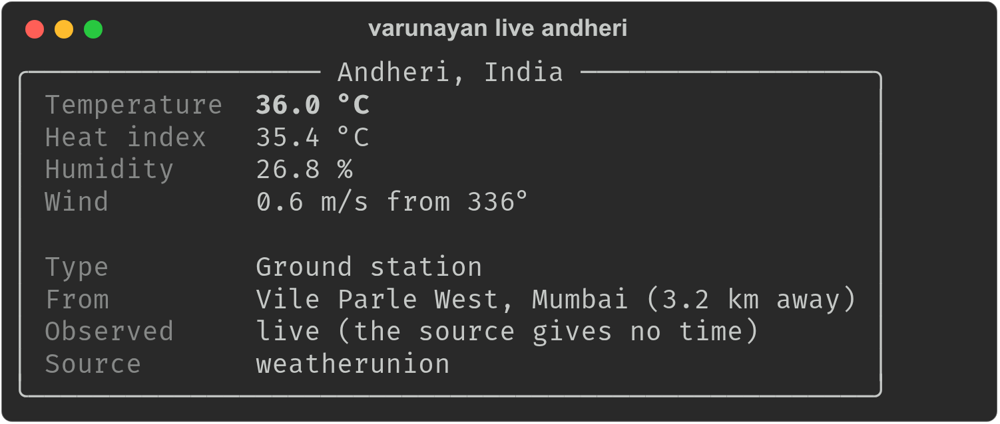

# varunayan 

Download and process climate data (ERA5, IMD, HadEX3, CRU TS) for a bounding box, GeoJSON region or point, with heat stress indices (UTCI, WBGT, Heat Index, Humidex).

| Package | Folder | Install | Docs |
|---|---|---|---|
| Python | [`python/`](python) | `pip install varunayan` | https://varunayan.saketlab.org/python/ |
| R | [`R/`](R) | `devtools::install_github("saketlab/varunayan", subdir = "R")` | https://varunayan.saketlab.org/R/ |

## Live weather in your terminal

The Python package shows the most local reading available, and says what kind of reading it is and how old it is:

```bash
pip install varunayan
varunayan live                               # your location, from your IP
varunayan live andheri                       # any place by name
varunayan live --lat 19.08 --lon 72.88       # coordinates
varunayan live mumbai --source open-meteo    # weatherunion, openweathermap, metar or open-meteo
varunayan live mumbai --json                 # JSON instead of a table
```


